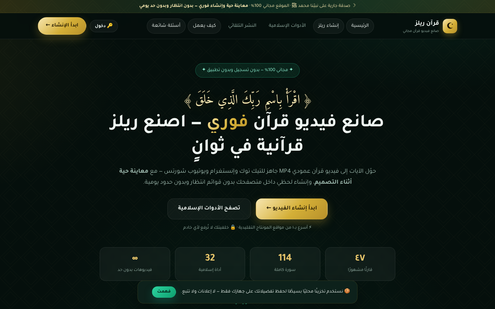

# قرآن ريلز — Quran Reels ⭐



**المستودع**: https://github.com/Ansygroup/quran-reels (عام · `main`) · النشر: Vercel · الدفع المستقبلي: `scripts/gh_push.sh`


**صانع فيديو قرآن مجاني وفوري** — نسخة مطوّرة بالكامل من quranreels.tech تعمل **داخل المتصفح** بدون خوادم معالجة وبدون قوائم انتظار وبدون حدود يومية.

🔗 **الفكرة في سطر واحد:** اختر الآيات ← شاهد المعاينة الحية ← اضغط «إنشاء» ← حمّل ملف MP4 عمودي 1080×1920 خلال ثوانٍ.

🌐 **منشور الآن:** https://quran-reels-tau.vercel.app

---

## ✨ المزايا (مقارنة بالأصل)

| | الأصل | هذه النسخة |
|---|---|---|
| الإنشاء | طابور خادم 1–3 دقائق + 10 فيديوهات/يوم + 30 ثانية تبريد | **فوري داخل المتصفح** بلا حدود وبدون تسجيل |
| المعاينة | غير متوفرة | **معاينة حية أثناء التصميم** (تشغيل/تقديم/تنقل بين الآيات) |
| الخصوصية | رفع للخادم | **الصوت والصور لا تغادر جهازك** (رفع خلفية محلي) |
| الأدوات | 24 أداة | **32 أداة** تعمل دون إنترنت حيث أمكن |
| التصدير | MP4 من الخادم | MediaRecorder داخل المتصفح: **MP4/WebM** حسب دعم المتصفح، مع تقدير الأبعاد 9:16 / 1:1 / 16:9 |

## 🎬 الصانع

- **47 قارئًا** (كل ayah mp3 من everyayah عبر `/proxy` موحّد المصدر — مطلوب لالتقاط الصوت في التصدير)
- **114 سورة** + نطاق آيات يدوي أو «رسائل سريعة» (الصبر، السكينة، الرزق، التوبة… 324 مرجعًا متحققًا)
- **ترجمة داخل الفيديو بـ8 لغات** (إنجليزية، فرنسية، تركية، إندونيسية، أردية، إسبانية، إيطالية) + عربي مبسّط
- **14 خلفية** (10 صور مولّدة + 4 تدرّجات) + رفع صورة من جهازك (محلي فقط)
- أنماط بطاقة (card/glow/banner) × 4 ألوان ذهبي/زمردي/فضي/وردي، عدّ حجم الخط، علامة مائية، إهداء «صدقة جارية» بثلاثة أنماط، إيقاف الحركة، شارة عنوان السورة، شريط تقدّم، ترجمة قابلة للإخفاء
- **معاينة حقيقية**: صوت كل آية + رسم Canvas بنفس كود التصدير (لا مفاجآت)
- **تصدير لحظي**: `canvas.captureStream` + `MediaRecorder` مع شريط تقدّم وإمكانية الإلغاء، ثم تحميل/مشاركة/فيديو فوري

## 🧰 الأدوات الـ32

مواقيت الصلاة (12 طريقة + تحديد موقع دقيق بتوقيت المنطقة) · القبلة (بوصلة + SVG + خريطة) · التاريخ الهجري/الميلادي · أذكار الصباح والمساء (حصن المسلم كامل — 132 فئة) · المسبحة · أسماء الله الحسنى · آية اليوم · آيات بالموضوع · حلقة التلاوة · خطة الختمة · **الختمة الجماعية برابط قابل للمشاركة** · مخارج الحروف · إذاعة القرآن (بث مباشر) · الأحاديث (النووية/القدسية مضمّنة + البخاري ومسلم وأبو داود والترمذي والنسائي وابن ماجه والموطأ بتحميل كسول) · تخريج الحديث · مصمّم البطاقات PNG · حاسبة الزكاة · المواريث (شاملة فرع واردث ووصية ووصية مطلقة) · أسماء المولودين (1017 اسمًا) · ألوان E · التقويم الإسلامي · عدّاد المناسبات · عدّاد الإفطار · تنبيهات الأذان (إشعارات + جرس) · أعمال اليوم · متتبع الصيام · قضاء الصلاة · حاسبة الكفارة · تعلم الصلاة · المساجد القريبة (OpenStreetMap) · الدعاء المختار

## 🏗️ البنية

```
quran-reels/
├── server.py              # خادم محلي: ثابت + /proxy (قائمة بيضاء) + /api/ip + /api/app-config
├── vercel.json            # إعدادات Vercel: outputDirectory=public + إعادة توجيه /proxy → /api/proxy + كاش
├── .vercelignore          # ما لا يُرفع عند النشر
├── api/                   # دوال Serverless (Node) — مرآة كاملة لـ server.py
│   ├── proxy.js           # نفس عقد /proxy: 400/403/502 + كاش 6 ساعات + ACAO *
│   ├── ip.js              # نفس عقد /api/ip مع نفس البديل الافتراضي (القاهرة)
│   └── app-config.js      # إعدادات عامة (Supabase URL + المفتاح العام) من متغيرات البيئة
└── public/
    ├── index.html         # الصفحة الكاملة (SEO + JSON-LD + FAQ)
    ├── css/style.css      # نظام تصميم RTL (تاجوال/أميري/أميري قرآن)
    ├── js/
    │   ├── data.js        # القراء، الترجمات، الخلفيات، FAMOUS، الأدوات…
    │   ├── core.js        # أدوات + حساب المواقيت (PrayTimes) + القبلة + الهجري + الراوتر
    │   ├── quran.js       # تحميل المصحف + الاختيارات + فهرس البحث
    │   ├── reel.js        # رسم الفيديو (Canvas) + AyahPlayer + ReelRecorder
    │   ├── creator.js     # واجهة الصانع وتدفق التصدير
    │   ├── tools.js       # إطار الأدوات المساعدة
    │   ├── tools-a/b/c.js # الأدوات الـ32
    │   └── app.js         # الإقلاع والصفحة الرئيسية
    ├── data/              # المصحف (2.1MB) + 7 ترجمات + أذكار + أسماء + أحاديث
    ├── fonts/             # Amiri / AmiriQuran / Scheherazade / Tajawal
    └── img/backgrounds/   # 10 خلفيات مولّدة (بلا نصوص)
```

## 🚀 التشغيل

```bash
cd quran-reels
PORT=8787 python3 server.py
# ثم افتح http://localhost:8787
```

- لا توجد تبعيات (Python 3 مكتبة فقط + Node للفحص الاختياري).
- `/proxy?u=` يقبل فقط: everyayah.com, api.alquran.cloud, cdn.jsdelivr.net, raw.githubusercontent.com, qurango.net, overpass-api.de, overpass.osm.ch, api.aladhan.com, nominatim.openstreetmap.org.
- `PORT` اختياري (افتراضي 8787) ويجب أن يُشغَّل على `0.0.0.0` ليعمل خلف وكيل المعاينة.

## 🌐 النشر على Vercel + Supabase

**Vercel** (الحساب متصل — المصادقة محفوظة داخل المشروع في `.vcfg` ولا تحتاج موافقة جديدة):

```bash
# مرة واحدة لكل بيئة عمل جديدة (إن لزم): npm i -g vercel  أو استخدم npx
npx vercel -Q "$PWD/.vcfg" deploy --prod --yes --scope ansygroups-projects
```

- الإعدادات في `vercel.json`: مجلد الخرج = `public`، و`/proxy` يُعاد توجيهه إلى `api/proxy`، وصفحات بدون امتداد تفتح التطبيق، وكاش CDN يوم للملفات الثابتة و6 ساعات للـproxy، ورؤوس `nosniff`/`Referrer-Policy`.
- متغيرات البيئة في المشروع (production + preview):
  - `SUPABASE_URL` · `SUPABASE_ANON_KEY` — تقرأها `api/app-config.js` ويستهلكها المتصفح.
- نطاق مخصص لاحقًا: أضِفه من لوحة Vercel ثم حدّث وسوم SEO إليه.

**تحصينات مطبَّقة (2026-10-27):**

- `api/proxy.js` + مرآته `server.py`: سقف حجم25MB · حدّ120 طلب/دقيقة/IP · دعم `Range` (تنقّل الصوت بـ206) · إعادة فحص مضيفي كل تحويل (حتى3) · كاش6س + كاش دافئ من الذاكرة.
- `/api/ip`: يقرأ رؤوس `x-vercel-ip-*` من حافة Vercel أولًا (بلا اعتماد خارجي وبلا rate-limit) ثم ipapi.co ثم بديل القاهرة.
- Supabase: صلاحيات أعمدة محدودة (`UPDATE` على `done`/`plan` فقط) + قيود (طول الاسم≤24، `done`≤365، تنسيق معرّف) + العميل يكتب عبر PATCH ثم INSERT (لا upsert). *البقيّة المقصودة: المفتاح العام يسمح بقراءة لوحة الختمة كاملة (بيانات تقدّم منخفضة الحساسية) — الحل الجذري عند الحاجة: Supabase Auth.*
- معرّفات خطط أقوى (16 محرفًا عشوائيًا عبر `crypto`).

**PWA / وضع دون إنترنت:**

- `public/sw.js` + `manifest.json` + `img/icon.svg`: يُخزّن الهيكل والبيانات الأساسية عند أول زيارة؛ التنقّل والأدوات تعمل دون إنترنت، و`/proxy`+`/api` شبكة دائمًا (لا يُخزَّن صوت). الإصدار الحالي `qr-v1` — عند تغيير ملفات الهيكل ارفع الرقم في `sw.js` لتجديد الكاش.

**Supabase — الختمة الجماعية المشتركة** (متزامنة بين الأجهزة):

- مشروع `quran-reels` بجدولتي `khatma_plans` و`khatma_progress` مع RLS (تقدّم كل فرد في صف مستقل).
- أداة «ختمة جماعية» تقرأ `/api/app-config`؛ عند غيابها تعمل **بدون سحابة** بهدوء (تراجع صامت).
- رابط المشاركة يحمل الخطة؛ التقدّم يُدفع عند «أنهيت اليوم» ويُسحب عند فتح الرابط على أي جهاز.

## 👤 الحساب + النشر التلقائي (الأتمتة) — الجديد

**تجربة المستخدم** (تعمل فورًا): زر «🔑 دخول» → رابط سحري للبريد أو «المتابعة بجوجل» → صفحة `#/account` فيها ربط المنصات بضغطة OAuth واحدة، جدول النشر، ومولّد البوستات، و«الأتمتة» اليومية. زر «🤖 جدولة للنشر» في نتيجة التصدير يرفع الفيديو إلى حسابك ويفتح نافذة الجدولة. الزائر يبقى حرًا — كل شيء (الإنشاء والأدوات) يعمل بلا تسجيل.

**كيف تُفعِّل النشر الفعلي (إعدادات المطوّر — مرة واحدة لكل منصة):**

| المنصة | متغيرات Vercel (Secrets) | أين تنشئ التطبيق | رابط إعادة التوجيه السجلّي |
|---|---|---|---|
| يوتيوب (ويُفعِّل جوجل الدخول لاحقًا) | `GOOGLE_CLIENT_ID` · `GOOGLE_CLIENT_SECRET` | Google Cloud Console → OAuth consent → Credentials | `https://quran-reels-tau.vercel.app/api/oauth/callback` |
| فيسبوك + إنستغرام | `META_APP_ID` · `META_APP_SECRET` | developers.facebook.com → My Apps | نفس الرابط أعلاه |
| تيك توك | `TIKTOK_CLIENT_KEY` · `TIKTOK_CLIENT_SECRET` | developers.tiktok.com | نفس الرابط |
| X | `X_CLIENT_ID` · `X_CLIENT_SECRET` | developer.x.com | نفس الرابط |

- **رابط إعادة التوجيه واحد لكل المنصات**: `/api/oauth/callback` (المنصة تُرمَّز داخل `state`).
- **دخول جوجل**: إعداد Supabase Dashboard → Authentication → Providers → Google (نفس عميل جوجل تقريبًا؛ سجّل redirect: `https://<ref>.supabase.co/auth/v1/callback`) — البريد السحري يعمل بلا أي إعداد (SMTP المدمج؛ حدّه الافتراضي **2 رسائل لكل نافذة وقت** — يُرفع من الداشبورد أو عبر SMTP خاص عند الحاجة).
- **الأتمتة**: Vercel Cron يوميًا `15 4 * * *` UTC (≈06:15 القاهرة) ينشر المهام المستحقة عبر `CRON_SECRET` — خطة Vercel المجانية تكفي (فيديو تلقائي/يوم). النشر الفوري متاح دائمًا من زر «انشر الآن».
- **التخزين**: فيديوهات الجدولة تُرفع إلى Supabase Storage bucket `reels` (عام — لحاجة المنصات لجلب الرابط) بحدّ 50MB/ملف؛ حدّ الـ1GB المجاني يكفي مئات الريلز.
- **الأمان**: التوكنات تُشفَّر AES-256-GCM بمفتاح `TOKEN_ENC_KEY` (خادم فقط)، JWTs تُتحقق ES256 عبر JWKS، الجداول محمية RLS بملكية المستخدم، ولا تظهر أي توكنات في الاستجابات.
- **`.env.secrets`** في جذر المشروع (مُستبعد من الرفع): نسخة محلية من `TOKEN_ENC_KEY` و`CRON_SECRET` — فقدانهما يعني إعادة ربط المنصات (لا ضرر).
- **حدّ Vercel**: خطة Hobby تسمح بـ12 دالة/نشرة — المجموع الحالي **11**. عند الإضافة ادمج المسارات (نمط `api/x.js` + استعلامات `?op=` كما هو هنا).
- **واقع المنصات** (بصدق): رفع يوتيوب مباشر (كوتا ~6 فيديو/يوم افتراضيًا، تُرفع بطلب) · إنستغرام يتطلب حساب Business + مراجعة تطبيق Meta · تيك توك مراجعة تطبيق (وضع الاختبار ينشر للمنشئين فقط) · X قد يتطلب خطة API مدفوعة لرفع الفيديو. كل ذلك أطراف خارجية — الكود جاهز ويعمل فور منح الموافقة.
- **الباقات** (مجاني/برو/مدى الحياة) معروضة كواجهة — الدفع الإلكتروني خطوة قادمة عند طلبك.

## ✅ الاختبارات

- حزمة الاختبارات الدائمة داخل المشروع: **`tests/run.js`** (Playwright) — تُشغَّل ضد الإنتاج أو الخادم المحلي:

```bash
cd tests
npm i playwright && npx playwright install chromium-headless-shell
npx playwright install-deps chromium-headless-shell   # مكتبات النظام (مرة واحدة)
node run.js                                              # محلي: 127.0.0.1:8787
BASE=https://quran-reels-tau.vercel.app node run.js      # الإنتاج
SKIP_EXPORT=1 node run.js                                # بلا قسم التصدير (~أسرع)
node tools_smoke.js                                      # دخان فتح الـ32 أداة (~5 ث)
node tools_interact.js                                   # تفاعل فعلي لكل أداة (نقر·select·input·checkbox)
node correctness_test.js                                 # صحة الحسابات مقابل Aladhan (30 فحصًا)
# الثلاثة الأخيرة تقبل BASE=… للإنتاج أيضًا
```

- ما تغطيه: الإقلاع + وسوم SEO وJSON-LD وrobots/sitemap + معاينة و**تصدير MP4 فعلي** + فتح الـ32 أداة بلا أخطاء + تفاعلات عميقة (مسبحة/زكاة/ختمة فردية/ختمة جماعية مع حالة السحابة/مواقيت/قبلة/أذكار/أحاديث/إذاعة/اختبار مخارج) + قائمة الجوال.
- **Lighthouse (موبايل مُحاكى): أداء 91 · وصولية 100 · أفضل الممارسات 100 · SEO 100** (FCP ‏1.0s · LCP ‏1.5s · CLS ‏0.07 · صفر فشل)
- **مدقّق W3C (validator.nu): 0 أخطاء · 0 تحذير** — تسلسل عناوين دلالي كامل (بما شامل عنوانَي `sr-only` لقسم الأداة و`v-tag` آية اليوم) — **وللصفحات الأربع الجديدة `/ar/*`: 0/0 لكل منها**.
- **طبقة فهرسة (جولة كمل#8)**: كانت كل روابط التطبيق `#/…` غير قابلة للفهرسة و sitemap = رابط واحد، فبُنيت **صفحات هبوط ثابتة بلا سكربتات** معناها غنيّ وJSON-LD وFAQ داخلي مترابط: `/ar/quran-video-maker/` · `/ar/islamic-tools/` (شبكة الـ32 أداة) · `/ar/prayer-times/` · `/ar/qibla-direction/` — sitemap الآن **11 مسارًا**، وروابط داخلية من تذييل الرئيسية إليها، ورؤوس أمان/caching ممتدّة لـ`/ar/(.*)`، وLH للصفحة الأولى **98/100/100/100**.
- **توسعة المحتوى وGEO (كمل#10 — «الرقم واحد»)**: +6 صفحات على كلمات المنافسين الحقيقية (`quran-video-tiktok` · `quran-video-with-translation` · `short-quran-verses-video` · `adhkar` · `tasbeeh` · `zakat-calculator`) — كلها W3C **0/0** ومولّدة عبر `scripts/build_lp.js` القابل لإعادة الاستخدام · **`/llms.txt`** بحقائق للاقتباس من محركات الذكاء · **robots.txt يسمح صراحةً بـ12+ وكيل ذكاء** (GPTBot·PerplexityBot·ClaudeBot·Google-Extended…) · **IndexNow أُعيد إيداعه بـ11 رابطًا HTTP 200** · **تقرير المنافسين** الكامل في `docs/competitors.md` (20 فاعلًا + مقارنة صريحة + أهداف قابلة للقياس).
- **وسم التحقق من Google** `google-site-verification` منشور في الرئيسية (خطوة GSC: تحقق ← إرسال sitemap ← طلب فهرسة الـ12 مسارًا).
- **خادم MCP (كمل#11 — «الذكاء يرشحك»)**: `POST /api/mcp` — خادم Streamable HTTP بروتوكولي `2025-06-18`/`2025-03-26` بلا مفاتيح ولا جلسات (JSON-RPC · دفعات · CORS) و**6 أدوات** تجعل محركات الذكاء *تنداء* الموقع: `quran_reel_maker_info` · `get_prayer_times` (9 طرق + توقيت IANA آمن DST) · `get_qibla` · `get_hijri_date` (أم القرى) · `get_verse` (عثماني ≤10) · `create_reel` (رابط `/?s=…&from=…&to=…` يفتح الصانع معبأًا) · اكتشاف `/.well-known/mcp.json` · وثائق `/developers/mcp/` (W3C 0/0) · مختبر `tests/mcp_test.js` **28/28**.
- **الدفعة الكبرى (كمل#12 — «كلهم»)**: **58 صفحة جديدة** عبر `scripts/build_k12.js` = قسم إنجليزي `/en/` (6 صفحات مزدوجة اللغة مع `hreflang` على 6 أزواج عربي↔إنجليزي) + **فهرس القرّاء و47 صفحة قارئ** (`/ar/reciters/` + `/ar/reciter/<slug>/`) بأزرار `/?r=<folder>` تفتح المولّد مُهيّأً بصوت القارئ (تعريب عميق في `applyDeepLink`/`handlePending` + وسيط اختياري في أداة MCP `create_reel`) + **صفحات الثقة** (`/about` · `/terms` · `/privacy` · `/contact` بنموذج يعمل على RPC دفاعي `submit_contact` بجدول RLS بلا قراءة) · فواتير موحّدة بالروابط الثقة في كل الصفحات · Sitemap **12→70** · llms.txt محدّث · W3C **70 صفحة 0/0** · مختبر `tests/pages12_test.js` **21/21** · IndexNow **70@200**.
- **المدونة والموسمية (كمل#13)**: **`scripts/build_blog.js`** → فهرس `/blog/` + **8 مقالات** على كلمات الأصل الحقيقية (٣٠ فكرة · هل توجد أداة مجانية؟ · جدول مقارنة مع quranreels.tech/tashghil/quranvideomaker ·7 أخطاء · الجدولة والأتمتة · **خطة رمضان1448** أم القرى:1 رمضان≈8 فبراير2027 · محتوى الجمعة · أول فيديو في5 دقائق) — كل مقال بـ`Article`+`BreadcrumbList`+`FAQPage` JSON-LD و`<time>` وقراءة معلنة · رابط «مقالات» في فواتير الموقع كلّه (قوالب×3 + الجذر + الثابتة) · Sitemap **70→79** · llms.txt قسم المدونة · W3C **79×0/0** · مختبر `tests/blog_test.js` **12/12** (يشمل فحص CJK وروابط داخلية حيّة ومسارات sitemap الدقيقة) · IndexNow **79@200**.
- **المراقبة + كلمة-بكلمة + الحزمة + المؤجَّل (كمل#14 — «كلهم»)**: أسلوب **«كلمة-بكلمة»** الرابع في صانع الريلز (`reel.js _drawWords`: إبراز الكلمة الجارية بقرص ذهبي موزون بالحروف على زمن التلاوة الحقيقي — صوت مفكّك أو تقدير — مع مطابقة سطور `_fitAyah` حرفيًا، واختبار S3 في run.js) · **مراقبة أسبوعية**: `npm run monitor` (`scripts/monitor_site.js` + `lib/monitor.js` — كل مداخل sitemap بحالة 200 + robots/llms/علامة GSC/تذييل المدونة + **diff منافسين** بقوائم جديدة/محذوفة + استعلام Bing RSS للفهرسة وتقرير Markdown يومي في `docs/monitor/`) **+ Vercel Cron** إثنين 06:30UTC (`/api/cron/monitor`) · **بريد تأكيد التواصل**: `api/contact.js` يمرّ على RPC ثم يرسل تأكيدًا للمراسل ونسخة للمسؤول عبر `lib/mailer.js` (Resend، بلا مفتاح = no-op) مع مسار احتياطي مباشر في النموذج · **عيب OAuth مُصحَّح**: `redirect_uri` للمنصات الأربع كانت لمسارات غير موجودة → موحَّد على `/api/oauth/callback` · **حزمة اقتباسات خارجية** `docs/backlinks.md` (ورقة حقائق +8 أهداف بروابطهم +3 قوالب رسائل + خطة أسبوعية) · محاضر الإعداد: `docs/{github,domain,oauth,payments,smtp}-setup.md` + مسودة `sql/credits-draft.sql` (غير مُطبَّقة) + **`scripts/rebase_url.js`** لتبديل النطاق بأمر واحد بعد ضبط DNS · مختبر pages12 **21→24**.
- **GSC وسم التحقق (كمل#15)**: الرمز `IHmoe5QFrC77PbZdh2O0MeZFLIKwg-saA50td32AcQo` مثبَّت الآن في **79/79 صفحات** — أُضيفت الناقصة الأربع (`ar/quran-video-maker` · `ar/islamic-tools` · `ar/prayer-times` · `ar/qibla-direction`) بنفس موضع القالب · المراقبة تفحص الآن **مطابقة القيمة الدقيقة** لا مجرد الوجود (`lib/monitor EXPECTED_VERIF`) · اختبار دائم في pages12 (`GSC token exact on home`) · الخطوة التالية: GSC → Verify → سجل Sitemap (79) → طلب الفهرسة · **ملف التحقق `googleb789508316de731f.html`** (أسلوب رفع الملف — 53 بايت حرفيًا في الجذر) مع حارس في pages12 (**24→25**).
- **صفحات المنصّات (كمل#17)**: `quran-video-instagram` · `quran-video-whatsapp` — **بنصّ الأصل الحرفي** (عنوانهما ووصفهما مأخوذان من صفحتيهما المنشورتين في quranreels.tech) + `quran-video-facebook` **بكلماتنا** (الأصل لا يملك صفحة فيسبوك — تحقّقت من خريطته الـ90) — كل صفحة بـ`WebPage`+`FAQPage` JSON-LD وروابط متقاطعة (تيك توك ↔ المنصّات) · **إصلاح رابط ميّت**: `/ar/quran-reels-for-dawah/` كان في صفحة الترجمة ولا وجود له ← استُبدل بستاتس واتساب · Sitemap **79→82** · llms.txt +3 · W3C **5 صفحات معدَّلة 0/0** · pages12 **25→27** (يشمل جولة 82 رابطًا self-canonical) · IndexNow **200×3** · monitor 82/82.
- **صفحات الموسم والفئات (كمل#18)**: **21 صفحة جديدة** — سلسلة **«كم باقي»** (hub + رمضان2027/الفطر/الأضحى/عرفة/رجب/شعبان/الجمعة: تواريخ أم القرى **بنصّ الأصل** مع تدرّج «قد يختلف يومًا بالرؤية» + **عدّاد حيّ `id="kbc"`** داخل كل صفحة، والجمعة يحسب نفسها أسبوعيًا في المتصفح) + **التهنئة بالاسم** (hub + عيدان + جمعة + رمضان — عناوين الأصل مع وصف مُكيَّف لإهدائنا أسفل الفيديو بدل «بطاقة الافتتاح» التي ليست عندنا) + **7 فئات أدوات** (`islamic-tools/{prayer-and-place,quran-discovery,quran-learning,dhikr,hadith-and-learning,calculators-and-tracking,family-and-life}` بعناوين ووصفات الأصل وأدواتنا موزّعة) + **`/ar/quran-word-highlight/` بكلماتنا** (slug الأصل معطّل 404 فملكِلناه) · إشارات الميزة: **سؤال FAQ الجذر الـ16** في `data.js` (يعيد بناء run.js) + **صف في جدول مقارنة المدونة** (مع تصريح صريح بأن للمنافس أيضًا «كلمة بكلمة») + llms · **build_lp 9→30** · Sitemap **82→103** · pages12 **27→29** (فحص الكلمة المفتاحية + فحص العدّاد) · run.js **87/0** · blog **12/12** · correctness30 · smoke32 · mcp28 · interact32 · W3C **23×0/0** (validator.nu) · **Lighthouse 91/98** (الرئيسية/المصصّم — بلا انحدار عن خط الأساس مع تشتّت طبيعي 79–95، وأُضيف `preload` لـ`style.css` لتقليل render-blocking) · IndexNow **21@200/202** · monitor **103/103**.
- **استكمال خريطة الأصل + تجديد التصميم (كمل#19 «الكل»)**: **51 صفحة جديدة تُغلق كل الفجوات** المتبقّية من sitemap الأصل (90 رابطًا — لم يبقَ منها إلا ما هو مغطّى بمسار آخر): **24 صفحة أدوات مفردة** بنصوص الأصل (`qibla` · `hijri-date` · `islamic-calendar` · `ayat-bil-mawdoo` · `daily-ayah` · `quran-radio` · `quran-looper` · `quran-khatma` · `group-khatma` (يُصلح رابطًا ميّتًا كان في كمل#18) · `hisn-almuslim` · `asma-allah-husna` · `hadith` · `hadith-checker` · `how-to-pray` · `mawarith` · `kaffara` · `qada` · `sawm` · `baby-names` · `nearby-mosques` · `minshawi-rare` · `makharij` · `tahfeez` · **`quran-quiz` باختبار حقيقي8 أسئلة داخل الصفحة** · `crypto-zakat` بحاسبة يدوية + تنبيه علمي · `halal-product-checker` — **بكلماتنا** لأن «الباركود والصورة» ليسا عندنا) + **13 صفحة صانع متخصّصة** (`no-watermark` · `no-music` · `free-maker` · `quran-video-ramadan` · `quran-reels-ai` · `quran-translation-video` · `quran-tafsir-video` (صفحة حدود صريحة) · `khushoo` · `sadaqa-jariya` · `quran-word-highlight-video` + `yasser-dossary`/`mishary-rashid`(=`alafasy`)/`best-quran-reciters` بصفحات قرّاء حقيقية47) + `adhkar/{sabah,masaa,nawm}` + `guides/quran-reels-guide-2026` + `compare/quran-video-makers` (بدون ادّعاء «7» — جدولنا المُتحقَّق فقط) + **نسختا `ur/` و`id/`** (lang/dir صحيحة) + جذرية: **`/faq/`** و**`/content-sources/`** (شفافية المصادر) و**`/developers/` + `docs/en` + `integrations/n8n`** (MCP/JSON-RPC حقيقي بلا مفتاح) مع **redirect `/privacy-policy` → `/privacy` (308)** · **أوصاف الميزات الغائبة عُدِّلت بصدق** (بوصلة بلا توهّج أخضر · بلا «مشي» · بلا عمر هجري · بلا صورة حديث · بلا مجسّم3D…) · **بناء القالب**: `base`/`lang`/`dir` اختيارية (30→**81** صفحة مولّدة) · Sitemap **103→154** · pages12 **29→30** (+فحص ur/id lang+GSC) · **تجديد تصميم عابر** عبر `style.css` + قالبي lp/blog (hero بتدرّج ذهبي · hover/borders · focus-visible · selection · reduced-motion) مع **إصلاح CLS** ناتج عن `text-wrap:balance` (LH: المصصّم89→**97** بعد الإزالة) · W3C **90×0/0** · run **87/0** · blog12 · correctness30 · smoke32 · mcp28 · interact32 · LH **الرئيسية88–91 (خط الأساس91)** · IndexNow **51@200×3** · monitor **154/154**.
- **محرّك المقالات + 100 مقال + صور AI + تعميق الباك (كمل#20 «engine100 · ai · deepen»)**: **محرّك** `scripts/build_posts.js` يقرأ `posts/library{,_b}.js` (بنوك محتوى **8 عناقيد**: video13 · reciters12 · prayer13 · hifz13 · azkar13 · seasons12 · family12 · publishing12) + `posts/index{,_b}.js` (**مواصفات100 مقال فريد**: slug/عنوان ب sufix «| قرآن ريلز»/وصف/كلمات مفتاحية/مقدمة/3 نقاط/تطبيق/FAQ×2-3/روابط داخلية≥2) → **100 مقال على `/articles/<slug>/` + hub `/articles/`**: Article+BreadcrumbList+FAQPage JSON-LD · crumb «الرئيسية ← المكتبة» · `<time>` عربي · دقائق القراءة (كلمات/180) · ترابط مركّب (2 من بنك العنقود + «اقرأ أيضًا» +3 بطاقات ذات صلة + أداة العنقود + cluster links) · **8 صور AI** رائدة للعناقيد في `public/img/articles/<slug>.jpg` (hero+og تلقائيًا، والباقي og-cover) · **الفوترات كلها** أضافت «المكتبة» (قالب lp + قالب blog +64 صفحة ثابتة + محرّك المقالات نفسه) · **Sitemap 154→255** · llms.txt +قسم «مكتبة المقالات» · مختبر pages12 **154→255** · محلي كامل أخضر: **run 87/0 · blog 12/12 · correctness 30 · smoke 32 · interact 32 · api 0 · mcp 28** · **الحجم مُنسَب عمدًا**: «مليون مقال» مستحيل فيزيائيًّا ويعرّض الموقع لـ scaled-content-abuse (ask_user: engine100) — المحرّك جاهز لتمديد مئات المقالات القادمة ببنوك العناقيد نفسها.
- **GitHub (كمل#16)**: المستودع العام **https://github.com/Ansygroup/quran-reels** مرفوع بـ**18 التزامًا** ومتحقق من التطاقب (sha محلي = بعيد) · فرع `master` أُعيد تسميته `main` · التوكن في `.vcfg/gh_token` (600، متجاهل للـgit، لا يُطبع أبدًا) + `.vcfg/gh_repo` · **`scripts/gh_push.sh`** يعيد إضافة origin ويدفع بأمر واحد (مقاوم لمسح `.git/config`) · توثيق الحالة في `docs/github-setup.md`.
- **Lighthouse على مسارات الأدوات**: `#/tools` ‏= 95/100/100/100 · `#/tool/prayer` ‏= 94/100/100/100 — صفر فشل في كل المسارات.
- **سلسلة E2E REST دائمة `tests/e2e_rest.py`**: 13/13 على البناء النهائي (منح·JWKS·OAuth 401/302·تخزين رفع+عام·RLS ختمة·جدولة·نشر 502 بلا ربط·أتمتة·قائمة ربط).
- **دخان الأدوات الـ32 `tests/tools_smoke.js`**: يفتح كل أداة ويتحقق الرندر + غياب أخطاء الصفحة + عدم التجاوز الأفقي — **32/32 في ~5 ثوانٍ** على المحلي والإنتاج.
- **عطل تجميد مُصلَّح (كشفه الدخان)**: `hijriParts` كان يُنشئ `Intl.DateTimeFormat` لكل استدعاء، فحلقة `hijriToGreg` (×900 داخل أداة الرزنامة) كانت تُجمّد الخيط الرئيسي لعشرات الثواني (أداة `calendar` عالقة) — الآن المُنسّق واحد مخزّن في `core.js`.
- **اختبار الصحة `tests/correctness_test.js` — 30/30 محليًا وإنتاجًا**: مرجع خارجي مباشر (Aladhan) لحسابات اليوم: الهجري ↔ `gToH` + roundtrip · قبلة القاهرة/لندن/جاكرتا/نيويورك ±1° · مواقيت أم القرى (القاهرة) ↔ `method=4` بفارق **0–2 دقيقة** · الزكاة عبر DOM (٢٫٥٪ + نصاب ٨٥غ + حكمان) · أدوات نصية (`toAr`·`fmtTime`·`normAr`).
- **عطل هجري صامت مُصلَّح (كشفه اختبار الصحة)**: إعادة التسمية في جولة كمل#6 تركت `raw: fmt.format(date)` — `ReferenceError` يبتلعه `catch`، فكانت **كل** التواريخ الهجري تعرض افتراضيًا «١ محرم ١٤٤٨ هـ» والاختبارات تمرّ لأنها تفحص الرندر فقط — الآن `_HIJRI_FMT` في المسار الصحيح.
- **عطل DST مُصلَّح**: ثابت `tz` في جدول المدن كان يُخطئ **ساعة كاملة** أثناء التوقيت الصيفي (القاهرة `tz:2` مقابل `Africa/Cairo` = +3 اليوم) — الآن لكل مدينة منطقة IANA (`z`) تُشتق إزاحتها لليوم الحالي عبر `tzFromName` عند كل قراءة (مسارات: محفوظ/جهاز/IP/اختيار المدينة).
- **تفاعل الأدوات `tests/tools_interact.js` — 32/32 محليًا وإنتاجًا**: يتمرّس حتى ٤ حركات فعلية لكل أداة (نقر زر/رابط · تغيير select · إدخال آمن · تبديل checkbox) مع حارس تجميد ومنظّف حالة (Escape/hash/صوت) — الأدوات العرضية الخالصة (iftar/calendar/countdown) مُوثّقة كعرضية في الكود.
- **ملاحظة نطاق**: إعدادات المشروع تحوي `quran-reels.ansygroup.com` كـalias (يظهر في أمر النشر) لكن DNS لا يحلّه بعد — النطاق المرجعي `quran-reels-tau.vercel.app` سليم.
- أداء الإقلاع: `defer` لـ12 سكربت، تنفيذات الأدوات الثلاثة **تُجلب عند أول فتح أداة** (مقتناة في SHELL للأوفلاين)، خلفية الصفحة الرئيسية webp، كاش سنة للخطوط/الخلفيات/JS/CSS عبر `?v=3`.
- **النتائج الأخيرة (بناء كمل#7): chromium PROD 86/0 · LOCAL 81/0 · api 15/15 · الصحة 30/30 · تفاعل 32/32 · دخان 32/32 · LH 91/100/100/100** (firefox/webkit: 85/80 و85/80 على بناء `0d21c5c` مع `SKIP_EXPORT=1`: MediaRecorder مفقود/معطّل في headless لهما — قيد بيئة موثّق) · api_test يشمل: الأوفلاين عبر Service Worker، صف سحابة إنتاجي، قسم S9 للحساب/الأتمتة/عقود API — رفض الزائر401، **حارس زر جوجل**: المزوّد غير المُفعّل يعطي تنبيهًا بدل صفحة خطأ، رابط «النشر التلقائي» في القائمة، وFAQ = 15 مطابقة للـJSON-LD.
- **PWA كامل للتثبيت**: أيقونات `icon-192.png`/`icon-512.png` (+maskable) ومُشار إليها بـ`?v=2` لكسر كاش CDN، وإصدار SW = `qr-v3`.
- **رؤوس أمنية لكل `/api/*`**: `nosniff` + Referrer-Policy + `Permissions-Policy` (geo/self — كاميرا/ميكروفون ممنوعان).
- **محلل رموز الجلسة** `QRAuth.parseAuthHash`: يتحمل `#access_token=` و`#/…#access_token=` المزدوج و`?access_token=` (مُختبَر بثلاثة أشكال).
- **مسار الرابط السحري**: الإرسال مقبول للنطاقات الحقيقية (دُرّب بـ429 بعد قبوله)؛ صفحة التحقق `token_hash` تتطلب رمزًا واردًا من البريد فعلًا (جُرّبت بصلاحيات القاعدة ورُفضت بـ`otp_expired` كما هو متوقع) — إعداد `site_url` صار على الإنتاج.
- **مستودع git محلي** (80 ملفًا، `.gitignore` يحمي `.env*`/`.vcfg`/`.vercel`) — أول commit شامل كل شيء.
- **أداء معاينة الشبكات**: صورة `og-cover` أعيد ضغطها 2167KB→95KB (1200×630 JPEG) ومُحدَّثة في og/twitter + JSON-LD مع `?v=2` — ومُتحقَّد أن كل مسارات SW (21) تعيد 200 وسجلات الإنتاج خالية من الأخطاء.
- **زر تثبيت التطبيق PWA**: يظهر بحدوث `beforeinstallprompt` ويخفي بـ`appinstalled` (فحصان جديدان في S9).
- **CSP صارم على HTML**: `script-src 'self'` (لا سكربتات داخلية/معالجات `onclick` — أُعيد توجيه زر الإنشاء إلى JS)، connect/media pin للمصادر الحقيقية (Supabase/everyayah/overpass/jsdelivr/qurango)، `frame-ancestors 'none'` + `X-Frame-Options: DENY` + Referrer-Policy — والاثنان والثمانون فحصًا تمرّ دون أي انتهاك.
- **تكامل iOS**: `apple-touch-icon` من PNG-192 + `theme-color` موجود.
- **`sql/schema.sql`**: نسخة مخطط كاملة (5 جداول + RLS + 14 سياسة + 6 فهارس، من الكتالوج الحي) للاستعادة — بلا أي سر.
- **حارس توافق**: رسالة عربية واضحة إن غاب MediaRecorder بدل خطأ تقني.
- **تدقيق أداء**: SHELL ‏= 2.8MB فقط (الترجمات الـ12MB عند الطلب)، brotli مُفعّل، 21 مسار SW كلها 200.
- **اختبار متصفح مضاعف**: `PW_BROWSER=firefox node run.js` (chromium افتراضي) — Firefox أخضر 85/80 بـ`SKIP_EXPORT=1` لأن `MediaRecorder` يعلّق في Firefox headless (سُجّل بملء قيد بيئة في run.js؛ تصدير MP4 مُختبَر على chromium).

  لربطه بـGitHub لاحقًا (بمُشتركك أنت — لا تُلصق التوكن هنا أبدًا):

  ```bash
  gh auth login            # أو استخدم PAT عبر GH_TOKEN
  gh repo create quran-reels --private --source=. --push
  # أو يدويًا:
  # git remote add origin https://github.com/<user>/quran-reels.git
  # git push -u origin main
  ```
- **فحص عقود الوحدات `api_test.js`: 15/15** (ACAO · كاش · Range206 · 405 · rate-limit429 · X-Cache HIT · ip · app-config).
- **جدولة Vercel مؤكَّدة**: `vercel crons ls` → `/api/cron/publish` · `15 4 * * *` (يوميًا).
- **E2E كامل بحساب حقيقي (يدوي، خارج المجموعة)**: منح جلسة → رفع فيزيو للتخزين (200 + رابط عام) → إدراج مهمة بـRLS → جدولة عبر API → نشر بلا ربط ⇒ `failed` برسالة عربية مُدارة → أتمتة upsert → واجهة بحساب مسجّل 8/8 (بطاقة المستخدم، قوائم، نافذة الجدولة، توليد البوست، خروج ينظّف الجلسة) — وكل البيانات نُظّفت بعدها (0 صف).
- ملاحظة بيئة العمل: كل رد من المستخدم ينظّف `node_modules` وذاكرة المتصفح — أعد `npm i playwright && npx playwright install chromium-headless-shell` (+ `install-deps` إن لزم) قبل أي تشغيل جديد.
- التحقق من بيانات الملفات: فحص مطابقة الـ44 ملفًا بين النشرة المحلية والإنتاج (HEAD 200 للكل)، وعقد دوال Vercel بـ13 فحص (`api_test.js` سابقًا)، وإثبات مزامنة السحابة بجهازين على الإنتاج.

## 📝 ملاحظات

- التصدير يلتقط الصوت الحي من مشغّل WebAudio (`MediaStreamDestination`) — يجب مرور الصوت عبر نفس الأصل (`/proxy`) لتجاوز قيود CORS.
- الموقع منشور على `quran-reels-tau.vercel.app` (كل وسوم SEO وrobots/sitemap عليه). عند ربط نطاق مخصّص لاحقًا: بدّل النطاق في `index.html` (canonical/og/JSON-LD) و`robots.txt`/`sitemap.xml` ثم أعد النشر.
- الاختبارات: `tests/run.js` (التشغيلان أعلاه خضراء: PROD 65/0 · LOCAL 64/0) — حزمة دائمة داخل المشروع بدل الملفات المؤقتة السابقة.
- ملاحظات بيئة العمل: مجلدات التبعيات (`node_modules`، ذاكرة المتصفح، CLI) تُنظَّف مع كل رسالة — أعد تثبيتها بالأوامر أعلاه عند الحاجة؛ ملفات المشروع والبيانات تبقى كما هي.
